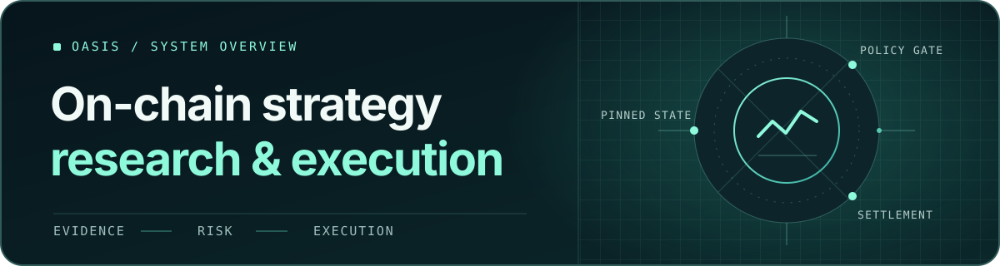

# Oasis Agent



[Quickstart](#quickstart) · [System design](#system-design) · [Operating tracks](#operating-tracks) · [Evidence index](docs/CURRENT_IMPLEMENTATION.md)

Oasis Agent is an evidence-driven on-chain research and execution system. It evaluates strategy
decisions against pinned chain state and reconciled accounting. Its objective is risk-adjusted
net asset value growth after all costs.

## System design

| Layer | What it establishes |
| --- | --- |
| **Evidence** | Retains original provider responses and binds observations to a chain, block hash, source, and input configuration. |
| **Research** | Replays decisions, attributes inventory and gas movements, and tests strategy behavior in shadow and simulation. |
| **Risk** | Checks account state, loss and exposure limits, transaction scope, and release authority independently of the strategy. |
| **Execution and settlement** | Isolates signing authority, reconciles receipts and balances, and preserves STOP and recovery state. |

The [project charter](docs/PROJECT_CHARTER.md) defines the objective and promotion gates.
The [production control framework](docs/governance/PRODUCTION_CONTROL_FRAMEWORK.md) defines the
operating boundaries. **Private keys and signing seeds stay outside Git.**
The [custody model](docs/security/CUSTODY_AND_AGENT_KEY_MODEL.md) describes how signing authority is isolated.

## Operating tracks

| Track | Current scope |
| --- | --- |
| **Robinhood · Uniswap v4 LP benchmark** | Fixed-block research on pool state, fees, inventory, and routing. See the [Phase 1 LP blueprint](docs/strategies/ROBINHOOD_V4_AUTOLP_BLUEPRINT.md). |
| **Base · ETH/USDC v4 LP** | Release-gated Docker canary for one to three ticks. Retained evidence includes a two-tick hold and verified shutdown. Every new run requires current evidence and operator authorization. |
| **Base · Autonomous spot** | Shadow discovery, entry and exit decisions, a paper ledger, deterministic replay, and historical receipt review. OKX supplies market data with optional GMGN cross-checks. |
| **Local console** | Read-only financial evidence and operating status, with authenticated observation and shadow campaigns. |
| **Elysium · Same-chain arbitrage research** | Block-pinned quotes, historical receipt replay, and event-driven pool discovery on retained inputs. See the [verification and replay guide](docs/verification/ELYSIUM_CYCLE_RESEARCH_20261111.md). |
| **Metric · Event-driven research** | Chain-scoped discovery, pinned Metric/V3 quote composition and synthetic lending-loop stress accounting. The [quote experiment](docs/strategies/METRIC_V3_QUOTE_EXPERIMENT.md) retains failed observations; executable profit remains unproven. See the [multi-chain plan](docs/strategies/MULTICHAIN_LENDING_EXPERIMENT.md). |
| **Strategy research** | Hedging, market making, and portfolio allocation follow the [research roadmap](docs/strategies/LONG_TERM_PROFIT_ROADMAP.md). |

Sustained net profitability remains unverified. The
[current capability index](docs/CURRENT_IMPLEMENTATION.md) links each acceptance result to the
evidence and conditions for that run.

## Quickstart

Use Python 3.12 and `uv` for the offline demo. The full development environment also uses Node.js 22
and Foundry 1.8.1, as pinned in [CI](.github/workflows/ci.yml).

```bash
make install
make report
```

Open the [benchmark fixture report](reports/benchmark-hook-analysis.md) to inspect the offline LP
example. For the full retained-evidence replay, use the
[offline workflow guide](docs/operations/ONE_COMMAND_WORKFLOW.md). Run `make contract-install` before
the Solidity checks.

Start the local dashboard with `make run-server`, then open
[127.0.0.1:8666](http://127.0.0.1:8666). The loopback configuration reads retained journals.
Observation campaigns require an operations token and approved data sources.

## Operator entry points

| Task | Start here |
| --- | --- |
| Inspect static Base LP release and Docker readiness | `make live-docker-readiness` for offline checks. Runtime admission is evaluated separately. |
| Inspect the dedicated Base LP account | `make live-check` with the configured RPC pair and a current request allowance. |
| Run an authorized Base LP canary | [Base runbook](docs/operations/BASE_BOUNDED_RUN.md) for preflight, original ledgers, and STOP verification. |
| Recover a pending Base LP transaction | [Release and recovery guide](docs/operations/LIVE_RELEASE.md). Recovery can read chain state and update existing accounting. |
| Run or replay Base spot shadow | [Spot runbook](docs/operations/BASE_SPOT_SHADOW.md) for provider scope, replay, and receipt verification. |

## Repository map

| Path | Responsibility |
| --- | --- |
| [src/oasis_agent](src/oasis_agent/) | Market data, evidence, strategies, risk, execution, and the console |
| [contracts](contracts/) | Solidity hook, bounded executor, and invariant tests |
| [scripts](scripts/) | Research, verification, and operator entry points |
| [docs/verification](docs/verification/) | Dated inputs, acceptance results, and unresolved evidence |

Start with [Contributing](CONTRIBUTING.md), the [engineering rules](AGENTS.md), and the
[review policy](REVIEW.md). Use the [security policy](SECURITY.md) for private vulnerability reports.
