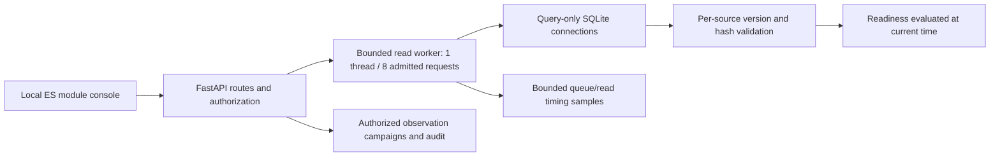

# Implemented console and read-model architecture

Updated: 2026-09-11. Scope: observation/control-plane refactor, not production trading approval.

The implementation preserves the Python domain packages and Solidity contract boundary. It removes
the synchronous journal read path from the API event loop, makes console capabilities discoverable,
and gives each frontend concern an explicit module. It deliberately avoids a new framework,
microservice deployment or native execution engine without a measured requirement.

This is an ownership diagram, not a claim of cross-database atomicity or a live market-data pipeline.
The operations branch controls observation processes and reviewed configuration; it does not grant
the console signing capability. Strategy proposals, risk policy, external custody and authoritative
settlement remain separate concerns.

## Backend responsibilities

| Module | Responsibility |
| --- | --- |
| `server/app.py` | Startup/shutdown, middleware, static assets, domain-error translation |
| `server/deps.py` | Typed service ownership in route dependencies |
| `server/read_worker.py` | Bounded admission, thread affinity, cancellation and draining |
| `server/databases.py` | Query-only reads, source-specific validation caches, evidence access |
| `reporting/lp_readiness.py` | Deterministic gate assessment at a supplied time |
| `server/console_contract.py` | API route ownership by navigable console view |
| `server/routers_*.py` | HTTP contracts, authorization and service coordination |

The read worker creates and closes SQLite connections on the same dedicated thread. Full reads
and changed-chain validation execute there. At most eight operations are admitted, including queued
work; excess admission fails with `ReadOnlyError(code="busy")` and HTTP 503. A disconnected HTTP
caller cannot prematurely release capacity: accepted work finishes, then releases its slot. Shutdown
drains accepted work and closes its connections. No observation or evidence records are dropped.

The worker retains 256 timing samples. `/api/v1/metrics` exposes queue/read p50/p95/p99 in nanoseconds,
sample count and scope. These bounded local samples include cold and warm reads and are not a live
trading SLO. This does not yet instrument RPC, strategy or landing stages.

Shadow and execution sources have independent version caches. A corrupt execution record cannot
make the shadow source report corrupt, or vice versa. Shadow decisions must reference retained
health evidence; sequence gaps are rejected. SQLite data versions detect commits through SQLite;
they do not verify chain finality, immutable bytecode, two-provider agreement or reconciliation.
Direct file replacement requires stopping the server first.

Readiness caches parsing, not eligibility. Every assessment is rebuilt against the current UTC time
(or an explicit test time). Expired evidence blocks eligibility even when the manifest bytes do not
change. The health endpoint validates the manifest instead of treating a configured path as proof.

## Frontend responsibilities

| File | Responsibility |
| --- | --- |
| `static/index.html` | Semantic pages, inputs, tables and accessible dialog |
| `static/console.css` | Shared appearance, layout and narrow-screen rules |
| `static/core.js` | Transport, formatting, exact integer parsing and rendering |
| `static/tables.js` | Bounded pages, stale-response suppression, evidence dialog |
| `static/operations.js` | Campaign/configuration editors, run controls and approvals |
| `static/console.js` | Read views, capability discovery, navigation and refresh wiring |

Scripts load only from this origin; CSP no longer permits inline script execution. Styles still
allow existing layout attributes. Setuptools package-data explicitly includes every console asset,
so installing a wheel does not lose the UI.

GET requests share work only while pending, then expire immediately. Page loaders discard superseded
responses, reset pagination when filters change, and clear old records on error. Page size is derived
from backend metadata. Journal pages can request descending sequence order; the existing ascending
default remains compatible. Offset pagination is a per-response view, not a retained snapshot across
multiple requests while new records arrive.

Unsafe JSON integer literals become decimal strings before JavaScript can round them. Canonical
decision/evidence detail documents are also supplied as backend-generated strings, preserving
integer literal text. Values are escaped before HTML rendering; dialog contents use textContent.
Browser presentation must not be used as a settlement or authorization source.

Every API path is assigned to a real view in `console_contract.py`, checked against OpenAPI and
rendered tabs. Related Launch endpoints share the aggregate dashboard; not every endpoint needs a
duplicate screen. The system page exposes route ownership and distinguishes read-only queries from
authorized operations. This mapping is navigation metadata, not an authorization policy.

## Design report disposition

The supplied [performance design](../../reports/oasis-performance-design/oasis-performance-design.html)
was reviewed as a proposal. Its Aleph-TX figures were not independently benchmarked here.

| Proposal | Current disposition |
| --- | --- |
| Detect changes before validation | Implemented with connection-local versions and per-source caches |
| Separate blocking reads from control loop | Implemented for the observation database read model |
| Bound work and preserve evidence | Implemented admission rejection; no drop semantics |
| Measure latency stages | Queue/read sample window implemented; broader instrumentation pending |
| Shared verified-head writer cache | Deferred to a separate journal invariant review and benchmark |
| RPC pooling, batching, provider rate control | Deferred; must retain independent two-provider agreement |
| Rust kernels | Conditional on representative CPU profiles and differential acceptance |
| Reorganize all domain packages | Deferred; module movement alone does not improve correctness |

The suggested incremental writer refactor affects journal integrity, restart behavior, HALT latches,
policy checks and competing writers. It should not be labelled low risk merely because strategy
parameters are unchanged. A SQLite version is not a block-pinned strategy snapshot.

## Limits and validation boundaries

Full changed-chain validation is still O(n), cache memory grows with history, and internal journal
records are treated as immutable by callers. Execution summaries still rebuild from events. Launch
aggregate reads and campaign snapshot reads use their existing thread paths; they do not yet share
this worker's admission limit or cache. Operations-journal I/O and response serialization remain on
the control loop and need separate profiling. No cross-database atomic snapshot is claimed.

Representative RPC/replay profiles, writer optimization, sustained shadow economics, complete
adversarial fork validation, license selection and public-release approval remain separate work.
Do not call this refactor a production-ready trader or a complete audit of every domain package.

## Verification on 2026-09-11

- `make check RUNNER='.venv/bin/python -m coverage run'` passed: 1,014 Python tests,
  108 subtests, 70 contract tests, zero contract failures/skips, lint, formatting, types and
  frontend syntax. After final worker startup/shutdown changes, `make python-check` with the
  same coverage runner passed again (1,014 tests, 108 subtests in 32.32 s), as did
  `make frontend-check`. Aggregate Python coverage: 89%.
- `make security-check` passed: no known dependency vulnerabilities, no medium/high Bandit
  findings, and secret checks passed. Bandit still records 44 low-severity findings.
- `make contract-security-check` passed: Slither analyzed 80 contracts with 102 detectors,
  zero results. This does not replace an adversarial fork campaign or independent audit.
- A wheel built with `pip wheel --no-deps --no-build-isolation` retained all six static assets.
- Browser smoke checks against temporary synthetic journals exercised all ten views, linked
  decision evidence, system capability mapping, and a 390-pixel viewport. No console warnings
  or errors were observed. This is not exhaustive accessibility or mutation-flow certification.
- Existing non-failing output includes one websockets deprecation warning and Forge lint/cache
  warnings. No contracts, live configuration, keys or deployment authority were changed.

## Research cockpit extension (2026-09-13)

The [research cockpit design](RESEARCH_COCKPIT.md) adds evidence-first navigation, an ordered
WP0–WP8 presentation model in `static/readiness.js`, and inspection guidance for the first
non-passing gate. It uses the existing read endpoints; no new authority or capital flow is added.
The document records implemented UI boundaries and the next bounded product architecture increments.
