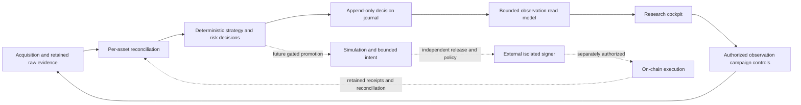

# Research cockpit and product architecture

Updated: 2026-09-13. Implemented scope: console presentation and navigation. The roadmap below
is a target design, not a claim of an autonomous production trader.

## Outcome and invariant

An operator should be able to answer: which evidence is available, what blocked promotion, and
where to inspect it next. A connected event stream, a passing test suite, an approval record and
execution eligibility are different facts. The UI must never turn one into another.

The cockpit consumes existing `/status` and `/readiness` reads. It adds no transaction path or
backend eligibility calculation. `/readiness` remains authoritative for its assessment time;
independent risk, release and signer controls remain authoritative for capital actions. Counts
must not be labelled percent complete or profitability. Missing data is visibly unresolved.

## Implemented product structure

| User question | Workspace | Evidence or control owner |
| --- | --- | --- |
| What needs attention next? | Task cockpit | Status and release assessment |
| Can I trust the inputs? | Health observations, evidence | Retained journals and provenance |
| Why did the agent decide this? | Decision chain | Decision and linked health evidence |
| What actually happened? | Execution | Retained execution events and HALT proofs |
| What is running? | Operations | Versioned observation campaigns and audit |
| Who reviewed promotion? | Gate approvals | Two-person approval records |
| Is infrastructure available? | Chains, system | Source integrity and read metrics |
| What is Launch observing? | Launch | Its separate aggregate journal read model |

Desktop navigation stays beside the workspace; narrow screens use a two-column navigation and
stacked content. Keyboard arrows, Home and End select tabs. Token entry belongs to Operations;
its existing memory-only handling is preserved. Workflow buttons only navigate.

`static/readiness.js` owns a small pure presentation model and its renderer. It requires exactly
one of each WP0–WP8 gate and a parseable assessment timestamp before presenting pass counts.
Duplicate, missing or unrecognised gate sets invalidate the entire path. Invalid expiry or status
renders the individual gate unresolved. Expiry equality is expired. The first non-passing gate
in canonical order supplies inspection guidance; this is a review sequence, not a scheduler.

The renderer clears prior optimistic results on read failure. It displays the server assessment
time, not a browser refresh timestamp as evidence freshness. It does not independently validate
provenance, verify findings, or reevaluate between polls. It inherits the console refresh cadence
and visibility behavior. Cross-source status and readiness reads are not an atomic snapshot.

## Target architecture and next bounded increments

Preserve the modular Python core and the separate contract/custody boundary. A product feature
should extend a typed read contract with evidence links before adding another screen or service.

The dotted edges are target integration and approval boundaries; the diagram does not assert that
a complete live loop exists. The research process cannot receive Treasury keys or pull authority.

1. **Evidence-linked campaign overview.** Expose campaign revision, target chain/pool, latest
   retained cycle, source time, integrity and termination reason in one typed read response. Preserve
   per-source timestamps; show incomplete data explicitly. Acceptance: restart, partial-source and
   stale-cycle tests, bounded read admission, and no credential-bearing RPC values in responses.
2. **Economic evaluation workspace.** Present untouched out-of-sample comparisons only when the
   experiment ID, split commitment, cost model, benchmark, sample size and evidence digest are
   available. Acceptance: separate per-token accounting from valuation; missing prices or unresolved
   residuals suppress return claims. Do not put synthetic NAV or APR on the cockpit.
3. **Incident investigation.** Link a HALT cause to its input evidence, affected intent and retained
   recovery proof. Acceptance: stale/corrupt sources cannot clear the incident; stopping an
   observation campaign cannot be labelled a position unwind.
4. **Simulation dossier.** Read the bounded preparation/simulation evidence through an explicit
   contract, with chain, block, runtime pins, intent digest and expiry visible. Acceptance: UI
   review cannot grant signing authority, and displayed status is invalidated when bindings change.

Each increment needs its own flow trace, tests and release evidence. Global allocation, arbitrage
and other strategy families follow the charter's ordering and independent economic gates.

## Verification and limits

The Node-executed model test covers complete assessments, exact expiry, invalid expiry/status,
missing and duplicate gates, clearing old passes, and navigation to the relevant workspace.
Existing dashboard refresh and API/view contract tests also run. Browser checks use an isolated
local server with no strategy data, no RPC configuration and disabled operation authorization;
empty-state screenshots are not live-chain evidence.

This change does not establish production readiness, economic edge, continuous strategy operation,
or full accessibility certification. See the task's validation report for exact gate results.
